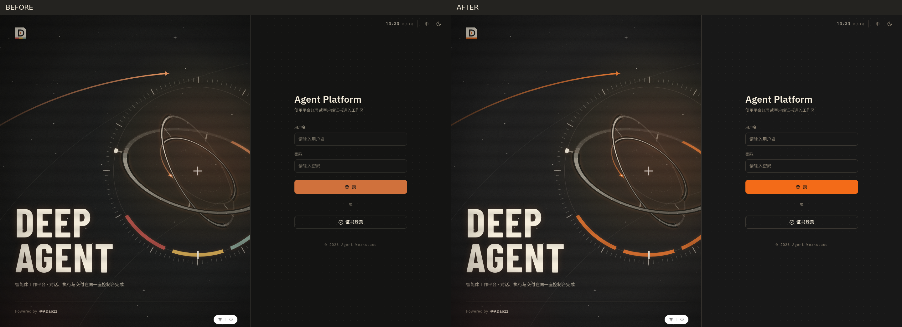
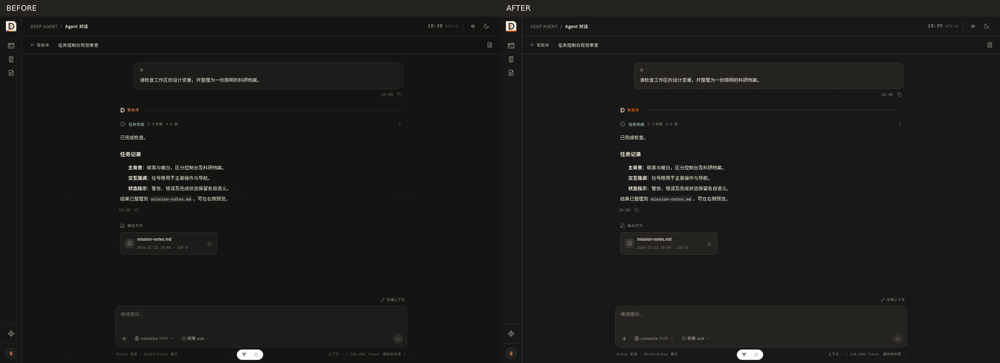
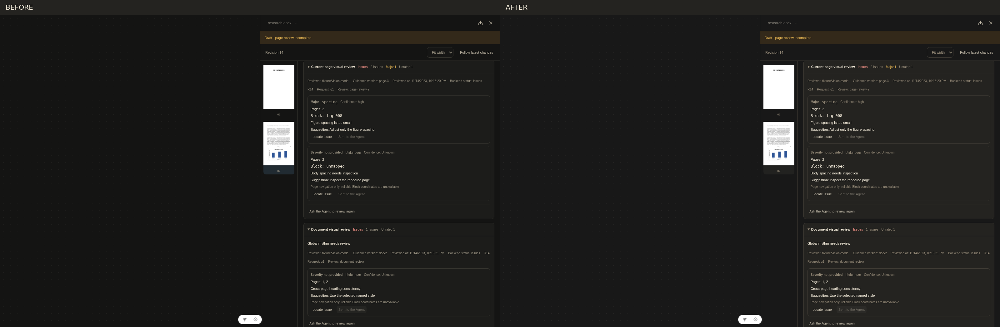
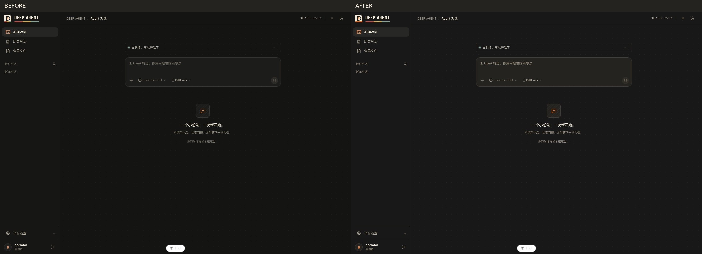
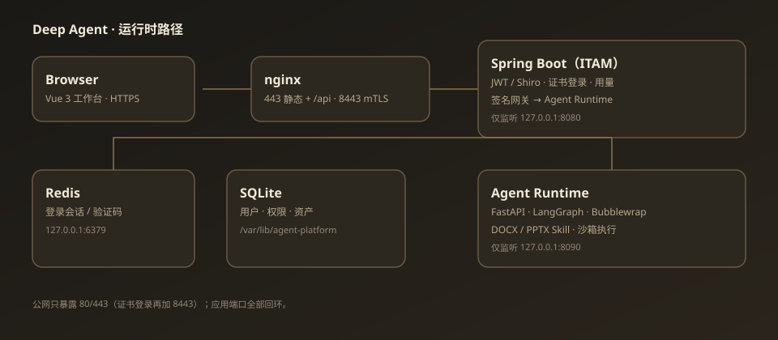

<div align="center">

# Deep Agent

**智能体工作平台：对话、执行与交付在同一座控制台完成。**

用自然语言把任务交给 Agent，在隔离环境中执行，并把可打开的 Word / PPT 直接带回工作台预览与下载。

[](#)
[](https://github.com/ADaozz/agent_platform)

[快速开始](#-快速开始) ·
[功能介绍](#-核心功能) ·
[文档](./docs) ·
[反馈问题](https://github.com/ADaozz/agent_platform/issues)

</div>

---

<div align="center">



*工作台主界面：对话、执行时间线与文档预览*

</div>

## ✨ 简介

Deep Agent 是一个面向团队的智能体工作台，解决「把调研、写作、排版交给 Agent，却拿不到可交付办公文档、也无法多人安全共用」的问题。

区别于只给聊天窗口的方案，本项目提供：

- **可交付产物** — Word / PPT 在隔离环境中生成，工作台内按页预览与下载
- **可控执行** — 实时时间线、工具审批、暂停 / 继续 / 追加指令，压缩上下文也算进步骤
- **多用户隔离** — 会话、文件与执行环境按账号隔离；支持密码、邮箱验证码与客户端证书登录

## 🚀 核心功能

### 01 — 与 Agent 协作

多轮对话、流式执行时间线、工具调用审批，以及运行中追加指令。历史可回看；每位用户的会话彼此隔离。输入区旁可查看轮次、步数与输出速度，悬停展开模型 / 工具用时与估算费用。



### 02 — 文档预览与文件库

生成的 DOCX / PPTX 支持按页预览；全局文件库按类型浏览。预览只挂在当前 Agent 对话上，切换菜单或新建对话会自动收起；依赖未就绪时也能关闭失败面板，而不是留下空白占位。



### 03 — 账号、证书与用量

邮箱验证码自助注册，或账号密码 / 客户端证书登录。管理员管理用户、角色与登录设备；个人可申请与管理证书。用量仪表盘按天汇总 Tokens 与估算费用，便于团队对照消耗。



## ⚡ 快速开始

### 环境要求

- JDK 8（后端构建与运行）
- Node.js 22.18+ 或 24.12+（仅前端构建）
- Python 3.12（Agent Runtime）
- nginx、Redis、Bubblewrap（生产）；LibreOffice 可选（文档正式分页渲染）

### 1. 克隆仓库

```bash
git clone https://github.com/ADaozz/agent_platform.git
cd agent_platform
```

### 2. 本地开发（分模块）

```bash
# 后端（SQLite profile）
cd backend && mvn -DskipTests spring-boot:run

# 前端
cd frontEnd && npm ci && npm run dev

# Agent Runtime
cd agent-runtime && python3.12 -m venv .venv && . .venv/bin/activate
pip install -r requirements.lock
# 文档预览还需：pip install -r requirements-features.lock
uvicorn platform_app.main:app --reload --port 8090
```

### 3. 单机生产部署

```bash
sudo cp deploy/deploy.env.example /etc/agent-platform/deploy.env
sudo chmod 600 /etc/agent-platform/deploy.env
# 编辑 DOMAIN / 邮件等参数；密钥由安装脚本生成到 secrets.env，勿把本机 deploy/local 提交进仓库

sudo deploy/scripts/install-host.sh
sudo deploy/scripts/build-release.sh
sudo deploy/scripts/release.sh /path/to/release-<版本>
sudo deploy/scripts/healthcheck.sh
```

详细步骤、TLS / 证书登录边界与踩坑见 [docs/DEPLOY.md](docs/DEPLOY.md)。

## 🏗️ 技术架构

| 模块 | 技术 |
|------|------|
| 前端 | Vue 3 / Vite / TypeScript |
| 平台后端 | Spring Boot 2.6 / JDK 8 / Shiro / SQLite |
| Agent Runtime | Python 3.12 / FastAPI / Bubblewrap 沙箱 |
| 入口 | nginx（443 静态 + `/api`；可选 8443 客户端证书） |

### 架构设计



组成与验收要点见 [docs/AGENT_WORKSPACE.md](docs/AGENT_WORKSPACE.md)；公网发布见 [docs/DEPLOY.md](docs/DEPLOY.md)。

## 📖 文档

| 文档 | 说明 |
|------|------|
| [部署与公网发布](docs/DEPLOY.md) | 依赖、安装、TLS、证书登录、备份回滚与常见故障 |
| [架构与部署](docs/AGENT_WORKSPACE.md) | 系统组成与验收要点 |
| [后台说明](backend/README.md) | 认证、注册、权限与接口 |
| [网页端说明](frontEnd/README.md) | 登录与工作台界面 |
| [Agent Runtime](agent-runtime/README.md) | 执行引擎与文档 Skill |
| [deploy/](deploy/README.md) | 生产部署脚本与配置模板 |

## 🗺️ Roadmap

- [x] 多用户工作台与会话隔离
- [x] DOCX / PPTX 生成与预览
- [x] 客户端证书登录与设备管理
- [x] 用量仪表盘与会话统计
- [x] 单机 nginx + systemd 部署套件
- [ ] 更完善的插件 / Skill 生态
- [ ] 性能与长会话稳定性增强

查看 [Issues](https://github.com/ADaozz/agent_platform/issues) 了解开发进度。

## 🤝 Contributing

欢迎提交 Issue 和 Pull Request。

1. Fork 本仓库
2. 创建功能分支
3. 提交修改（勿提交 `deploy/local/`、密钥、本机 IP / 邮箱等环境数据）
4. 发起 Pull Request

## ⭐ Support

如果这个项目对你有帮助，欢迎给仓库一个 Star。

---

<div align="center">

Made with care by [ADaozz](https://github.com/ADaozz)

</div>
