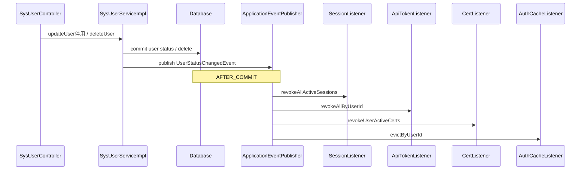

# DDD 解耦梳理：Impl 依赖、事务边界与改造路线图

> 基于 personalDemo Backend 现状整理。  
> 目标：先梳理 Impl 之间的**横向**依赖，再标每个用例的**垂直**事务与聚合边界，按「共进退收 Domain、跨上下文走事件/Port」解耦。  
> 相关实现：[UserStatusChangedEvent](../src/main/java/org/example/backend/system/user/event/UserStatusChangedEvent.java)（P0 ✅）、[VmHost 聚合](../src/main/java/org/example/backend/asset/host/domain/model/VmHost.java)（P1 Asset ✅）

---

## 1. 现状结论

当前 `*ServiceImpl` **不是错了**，而是典型 **Transaction Script + 贫血模型**，一肩挑了三层职责：

| 实际职责 | 应在 DDD 中的位置 | 现状 |
|---------|------------------|------|
| 用例编排、开事务 | Application Service | 大部分 `@Transactional` 在 Impl |
| 业务规则、不变量 | Domain（聚合 / Domain Service） | 散落在 Impl + `*Constants` |
| 持久化、Redis、文件 | Infrastructure | Mapper / Redis 直接注入 Impl |

**解耦目标：** 把三层分开，**不是删掉 Impl**；Impl 可演进为 `XxxApplicationService`，规则下沉 `domain/`，持久化收 `infrastructure/`。

---

## 2. 两种解耦方向

### 2.1 横向解耦（跨限界上下文）

一个上下文发生的事实 → 其他上下文各自响应，**编译期不直接依赖**。

```
IAM: SysUserServiceImpl
  → publish UserStatusChangedEvent
  → [AFTER_COMMIT]
       SessionListener / ApiTokenListener / CertListener / AuthCacheListener
```

**手段：** 领域事件 + `@TransactionalEventListener`、Port/Adapter（防腐层）。

### 2.2 垂直解耦（上下文内分层）

共进退的逻辑收进 **聚合**，Application 只做 `load → 调用聚合根 → save`，**一层只依赖下一层接口**。

```
Controller → ApplicationService → Aggregate / DomainService → Repository 接口
                                                      ↑
                                            Infrastructure 实现
```

**手段：** 聚合根封装不变量；Repository 抽象；Application 保持薄。

---

## 3. 限界上下文与 Impl 清单

| 上下文 | Impl | 文件路径 |
|--------|------|---------|
| **IAM** | SysUserServiceImpl | `system/user/service/impl/` |
| | SysUserRoleServiceImpl | `system/user/service/impl/` |
| | SysRoleServiceImpl | `system/role/service/impl/` |
| | SysRolePermissionServiceImpl | `system/role/service/impl/` |
| | SysPermissionServiceImpl | `system/permission/service/impl/` |
| | SysMenuServiceImpl | `system/menu/service/impl/` |
| **Auth** | AuthServiceImpl | `auth/service/impl/` |
| | LoginSessionServiceImpl | `auth/session/service/impl/` |
| | CertLoginServiceImpl | `auth/cert/service/impl/` |
| | CertApplyServiceImpl | `auth/cert/service/impl/` |
| | CertIssueServiceImpl | `auth/cert/service/impl/` |
| **API** | ApiTokenServiceImpl | `api/service/impl/` |
| | OpenApiDocServiceImpl | `api/service/impl/` |
| **Asset** | VmHostServiceImpl | `asset/host/service/impl/` |
| | VmAppServiceImpl | `asset/app/service/impl/` |
| **Statistics** | DashboardServiceImpl | `statistics/service/impl/` |
| **Quartz** | SysJobServiceImpl | `quartz/service/impl/` |
| **Audit** | SysOperLogServiceImpl | `common/operlog/service/impl/` |

---

## 4. 横向依赖矩阵

> **图例：** ● 同上下文（可接受）｜ ○ 跨上下文（解耦候选）｜ ◎ 基础设施（Mapper/Redis/工具）

### 4.1 依赖关系总览（改后）

> **图例**  
> `──>` 直接注入/调用（编译期依赖）  
> `-..->` Port / 事件（解耦后的间接依赖）  
> **绿色虚线框** = P0/P1 已改造区域

#### 4.1.1 跨限界上下文 — Impl 级总览

```mermaid
flowchart TB
    subgraph Security["Security 基础设施"]
        Realm[UserRealm]
        CacheEvict[AuthorizationCacheEvictor]
    end

    subgraph IAM["IAM 身份与访问"]
        UserSvc[SysUserServiceImpl]
        UserRole[SysUserRoleServiceImpl]
        RoleSvc[SysRoleServiceImpl]
        PermSvc[SysPermissionServiceImpl]
        MenuSvc[SysMenuServiceImpl]
    end

    subgraph Auth["Auth 认证"]
        AuthSvc[AuthServiceImpl]
        SessionSvc[LoginSessionServiceImpl]
        CertLogin[CertLoginServiceImpl]
        CertApply[CertApplyServiceImpl]
        CertIssue[CertIssueServiceImpl]
    end

    subgraph API["Open API"]
        ApiToken[ApiTokenServiceImpl]
    end

    subgraph Asset["Asset 资产管理 ✅ P1"]
        HostFacade[VmHostServiceImpl]
        AppFacade[VmAppServiceImpl]
        HostApp[VmHostApplicationService]
        HostQuery[VmHostQueryService]
        AppApp[VmAppApplicationService]
        HostRepo[(VmHostRepository)]
        UserPort[UserQueryPort]
        UserAdapter[UserQueryAdapter]
    end

    subgraph Stats["Statistics 读模型"]
        Dashboard[DashboardServiceImpl]
    end

    subgraph EventBus["Spring 事件总线 P0 ✅"]
        Event[UserStatusChangedEvent]
        LSession[SessionListener]
        LApi[ApiTokenListener]
        LCert[CertListener]
        LCache[AuthCacheListener]
    end

    UserSvc --> UserRole
    UserSvc --> RoleSvc
    UserSvc --> PermSvc
    UserSvc --> CacheEvict
    RoleSvc --> UserRole
    RoleSvc --> PermSvc
    RoleSvc --> CacheEvict
    MenuSvc --> RoleSvc
    MenuSvc --> PermSvc

    UserSvc --> Event
    Event -.->|AFTER_COMMIT| LSession
    Event -.->|AFTER_COMMIT| LApi
    Event -.->|AFTER_COMMIT| LCert
    Event -.->|AFTER_COMMIT| LCache
    LSession --> SessionSvc
    LApi --> ApiToken
    LCert --> CertIssue
    LCache --> CacheEvict

    AuthSvc --> UserSvc
    AuthSvc --> SessionSvc
    AuthSvc --> CertLogin
    SessionSvc --> UserSvc
    CertApply --> UserSvc
    CertApply --> CertIssue

    Realm --> UserSvc
    Realm --> RoleSvc
    Realm --> PermSvc
    Realm --> SessionSvc
    Realm --> ApiToken

    HostFacade --> HostApp
    HostFacade --> HostQuery
    AppFacade --> AppApp
    HostApp --> HostRepo
    AppApp --> HostRepo
    HostQuery --> UserPort
    UserAdapter -.->|实现| UserPort
    UserAdapter --> UserSvc
    HostRepo --> HostDomain[VmHost 聚合]

    Dashboard --> DMapper["DashboardMapper JOIN vm_host/sys_user"]

    style Asset fill:#1a3d1a,stroke:#4caf50
    style EventBus fill:#1a2d3d,stroke:#2196f3
```



#### 4.1.2 P0 — 用户停用/删除（横向事件解耦）



**要点：** IAM **不再**直接注入 `LoginSessionService` / `ApiTokenService` / `CertIssueService`。

#### 4.1.3 P1 — Asset 垂直分层（VmHost 聚合）

```mermaid
flowchart TB
    subgraph Interfaces["interfaces 接入层"]
        HC[VmHostController]
        AC[VmAppController]
    end

    subgraph Facade["service/impl 门面"]
        HImpl[VmHostServiceImpl]
        AImpl[VmAppServiceImpl]
    end

    subgraph Application["application 应用层"]
        HWrite[VmHostApplicationService]
        HRead[VmHostQueryService]
        AWrite[VmAppApplicationService]
    end

    subgraph Domain["domain 领域层"]
        Agg[VmHost 聚合根]
        Life[VmLifecycle 值对象]
        RepoIf[VmHostRepository 接口]
    end

    subgraph Infrastructure["infrastructure 基础设施"]
        RepoImpl[VmHostRepositoryImpl]
        Converter[VmHostConverter]
        HostMapper[VmHostMapper]
        AppMapper[VmAppMapper]
        Port[UserQueryPort]
        Adapter[UserQueryAdapter]
    end

    HC --> HImpl
    AC --> AImpl
    HImpl --> HWrite
    HImpl --> HRead
    AImpl --> AWrite
    HWrite --> RepoIf
    HWrite --> Agg
    AWrite --> RepoIf
    AWrite --> Agg
    HRead --> Port
    HRead --> HostMapper
    RepoIf --> RepoImpl
    RepoImpl --> Converter
    RepoImpl --> HostMapper
    RepoImpl --> AppMapper
    Port --> Adapter
    Adapter --> IAMUser[SysUserService IAM]
    Agg --- Life

    style Domain fill:#2d2d1a,stroke:#ffc107
    style Application fill:#1a2d3d,stroke:#03a9f4
```



**要点：**
- Host/App **Impl 之间无依赖**（已消除双向 `VmHostService` ↔ `VmAppService`）
- App 写路径通过 **`VmHostRepository` + 聚合规则** 校验 Host，不调用 Host Service
- 读（`VmHostQueryService`）与写（`VmHostApplicationService`）分离

#### 4.1.4 仍存在的跨上下文耦合（P2 目标）

| 调用方 | 被调用方 | 解耦手段 |
|--------|---------|---------|
| `AuthServiceImpl` | `SysUserService` | `UserQueryPort` / 认证专用 Port |
| `LoginSessionServiceImpl` | `SysUserService` | `UserQueryPort`（推广 Asset 已有） |
| `CertApplyServiceImpl` | `SysUserService` | `UserQueryPort` |
| `UserRealm` | User / Role / Perm / Session / ApiToken | 窄 Port：`UserStatusChecker` 等 |
| `UserQueryAdapter` | `SysUserService` | 防腐层（Asset 已用，合理） |
| `DashboardMapper` | 跨表 JOIN | P3 CQRS 读模型 |

### 4.2 逐 Impl 横向依赖明细

| Impl | 注入的其他 Service | 注入 Mapper/基础设施 | 跨上下文依赖 | 解耦建议 |
|------|-------------------|---------------------|-------------|---------|
| **SysUserServiceImpl** | UserRole, Role, Permission | UserMapper, AuthCacheEvictor | Security 缓存 | P0 已完成：停用/删除 → 事件；保留 assignRoles 清缓存 |
| **SysUserRoleServiceImpl** | — | UserRoleMapper | 无 | 作为 User 聚合内实体仓储或保持 |
| **SysRoleServiceImpl** | RolePermission, UserRole, Permission | RoleMapper, AuthCacheEvictor | Security 缓存 | 域内可接受；缓存可事件化（低优先级） |
| **SysRolePermissionServiceImpl** | — | RolePermissionMapper | 无 | 保持 |
| **SysPermissionServiceImpl** | — | PermissionMapper | 无 | 保持 |
| **SysMenuServiceImpl** | Role, Permission, RolePermission | MenuMapper | 无 | 读模型/组装，保持 |
| **AuthServiceImpl** | SysUser, LoginSession, CertLogin | JwtUtils | IAM, Session, Cert | 保持 Application 编排；User 改 `UserQueryPort` |
| **LoginSessionServiceImpl** | SysUserService | SessionMapper, Redis | IAM（查用户名） | `UserQueryPort`；DB+Redis 可拆 Repository+Cache |
| **CertLoginServiceImpl** | — | UserCertMapper | 无 | 保持；或归 Cert 聚合查询 |
| **CertApplyServiceImpl** | SysUser, CertIssue | ApplyMapper, CertMapper | IAM | User 改 Port；approve 规则下沉 CertApply 聚合 |
| **CertIssueServiceImpl** | — | UserCertMapper, CertProperties, 文件系统 | 无 | 定位为 Domain Service + Infrastructure |
| **ApiTokenServiceImpl** | — | TokenMapper, Redis, ApiJwtUtils | 无 | 保持；revoke 已由 Listener 触发 |
| **OpenApiDocServiceImpl** | — | Shiro Subject | Security 读权限 | 只读，保持 |
| **VmHostServiceImpl** | VmHostApplicationService, VmHostQueryService | —（无 Mapper 直注） | **UserQueryPort**（经 QueryService） | **P1 ✅** 门面：读/写均委托 Application |
| **VmAppServiceImpl** | VmAppApplicationService | AppMapper（列表） | **VmHostRepository**（写路径） | **P1 ✅** 已消除对 VmHostService 依赖 |
| **DashboardServiceImpl** | — | DashboardMapper（跨表 JOIN） | Asset+IAM 读模型 | **P3**：独立 QueryService / 物化视图 |
| **SysJobServiceImpl** | JobTaskExecutor, QuartzScheduler | JobMapper | Quartz 内 | `@Lazy` 循环；保持 |
| **SysOperLogServiceImpl** | — | OperLogMapper | 无 | 横切，保持 |

### 4.3 已解耦 vs 待解耦

| 状态 | 场景 | 方式 |
|------|------|------|
| ✅ 已做 | 用户停用 / 删除 → 吊销 Session/Token/Cert/缓存 | `UserStatusChangedEvent` + 4 Listener |
| ✅ 已做（Asset） | VmHost `updateVmHost` 写路径 | `VmHost` 聚合 + `VmHostApplicationService` + `VmHostRepository` |
| ✅ 已做（Asset） | VmHost `listVmHost` 读路径 | `VmHostQueryService`（与写聚合分离） |
| ✅ 已做（Asset） | VmHost 列表查 owner 名 | `UserQueryPort` + `UserQueryAdapter` |
| ✅ 已做（Asset） | VmApp `updateVmApp` 校验 Host | `VmAppApplicationService` + `VmHostRepository` + 聚合规则 |
| ✅ 已做（Asset） | VmApp ↔ VmHost 双向 Service | 已消除；App 写路径只依赖 `VmHostRepository` |
| 🔲 待做 | Auth / Session / CertApply → SysUserService | 复用 `UserQueryPort` |
| 🔲 待做 | UserRealm → 多 Service 扇出 | SessionValidator、UserStatusChecker 等 Port |
| 🔲 待做 | Dashboard 跨表 SQL | CQRS 读模型 |

---

## 5. 垂直梳理：事务与聚合边界

### 5.1 原则

| 问题 | 共进退 → 同一聚合 / 同一事务 | 分开 → 事件或分步 |
|------|---------------------------|------------------|
| DB 失败要一起 rollback？ | 是 | 否 |
| 同一业务概念？ | 是 | 否 |
| 同一限界上下文？ | 是 | 可跨上下文 |

**Domain 不开 `@Transactional`**；事务边界在 Application（Impl）的用例入口。

### 5.2 逐 Impl 用例分析

#### IAM — SysUserServiceImpl

| 方法 | @Transactional | 聚合候选 | 共进退范围 | 层归属建议 |
|------|----------------|---------|-----------|-----------|
| createUser | ✓ | User + UserRole | sys_user + sys_user_role | App 编排；admin 规则 → User 聚合 |
| updateUser | ✓ | User | sys_user；停用时发事件 | App + 事件 |
| deleteUser | ✓ | User | 删 user + role 关联 + 事件 | App + 事件 |
| assignUserRoles | ✓ | User + UserRole | 角色关联 + 清 Shiro 缓存 | App；规则 → User 聚合 |
| assertUserActive | — | User | 只读校验 | Domain / 供 Port 实现 |

**应收 Domain 的规则：** `assertNotLastAdmin`、`assertNotRemoveLastAdminRole`、用户名唯一（不变量）。

#### Auth — AuthServiceImpl（登录纵向流程）

| 方法 | @Transactional | 说明 |
|------|----------------|------|
| login / loginByCert | —（Session 内开） | **Application 编排**：User 校验 → Session 创建 → JWT |
| issueLoginSuccess | — | 调 Session.createSingleLoginSession（内含事务） |
| logout | — | 吊销单会话 |

共进退：创建会话（DB+Redis）在 `LoginSessionServiceImpl` 内，与登录用例绑定。

#### Auth — LoginSessionServiceImpl

| 方法 | 事务 | 存储 | 说明 |
|------|------|------|------|
| createSession / createSingleLoginSession | 隐式/可显式 | DB + Redis | 应用服务 + 基础设施混合 |
| revokeSession / revokeAllActiveSessions | — | DB + Redis | 被 Listener 或 logout 调 |
| assertSessionActive | — | Redis | 供 UserRealm |

**垂直拆分建议：** `SessionRepository`（DB）+ `ActiveSessionCache`（Redis），Application 编排。

#### Auth — CertApplyServiceImpl（P1 试点）

| 方法 | @Transactional | 共进退 | 应收 Domain |
|------|----------------|--------|------------|
| apply / reissue | ✓ | 插入 apply | assertNoPending → CertApply 聚合 |
| approve | ✓ | 改 apply + 签发 + 写 cert + 可能吊销旧证 | CertApply.approve() 状态机 |
| reject | ✓ | 改 apply 状态 | CertApply.reject() |
| revokeCert | ✓ | 改 cert 状态 | UserCert.revoke() |

#### Auth — CertIssueServiceImpl

| 方法 | 说明 | 层 |
|------|------|-----|
| issueForApply | BouncyCastle 签发 + 写文件 + persistUserCert | **Domain Service** + Infra |
| revokeUserActiveCerts | 批量改 cert 状态 | Infra / 被 Listener 调 |

#### Asset — VmHostServiceImpl（P1 ✅）

| 方法 | 状态 | 说明 |
|------|------|------|
| updateVmHost | ✅ | `VmHostApplicationService` → 聚合 → `VmHostRepository` |
| listVmHost | ✅ | `VmHostQueryService` 读模型 |
| ~~getVmHostOrThrow / assertCurrentUserIsOwner~~ | 已移除 | 规则在 `VmHost` 聚合；App 经 Repository 访问 |

#### Asset — VmAppServiceImpl（P1 ✅）

| 方法 | 状态 | 说明 |
|------|------|------|
| updateVmApp | ✅ | `VmAppApplicationService` → `VmHostRepository.findById` → `assertOperatorCanManageApps` |
| listVmApp | 🔲 可选 | 仍 ServiceImpl + Mapper；可后续抽 `VmAppQueryService` |

#### API — ApiTokenServiceImpl

| 方法 | 事务 | 说明 |
|------|------|------|
| createApiToken / deleteApiToken | 隐式 | DB + Redis |
| revokeAllByUserId | — | 被 UserStatusChanged Listener 调 |
| assertTokenActive | — | UserRealm 验签 |

#### Statistics — DashboardServiceImpl

| 方法 | 事务 | 说明 |
|------|------|------|
| 全部查询 | 无 | DashboardMapper JOIN vm_host / vm_app / sys_user |

**读模型**，与写路径分离；不必强行聚合。

#### 其他

| Impl | 事务方法 | 说明 |
|------|---------|------|
| SysRoleServiceImpl | createRole, updateRole, deleteRole, assignRolePermissions | IAM 内；删角色清 AuthCache |
| SysRolePermissionServiceImpl | assignPermissionsByRoleId | 角色-权限关联 |
| SysJobServiceImpl | updateSysJob, changeJobEnabled | Quartz 内聚 |
| SysOperLogServiceImpl | saveAsync（@Async） | 独立异步，无强一致 |

---

## 6. 层归属对照（目标态）

| 现有 Impl | 现在混了什么 | 目标拆分 |
|-----------|-------------|---------|
| SysUserServiceImpl | App + Domain 规则 + Infra | UserApplicationService + User 聚合 + UserRepository |
| AuthServiceImpl | App 编排 | AuthApplicationService（保持薄） |
| LoginSessionServiceImpl | App + Infra(DB+Redis) | SessionApplicationService + SessionRepository + SessionCache |
| CertApplyServiceImpl | App + Domain 规则 + Mapper | CertApplyApplicationService + CertApply 聚合 |
| CertIssueServiceImpl | Domain Service + Infra | 保持为 Cert 上下文 Domain Service |
| VmHostServiceImpl | 门面（读 Query + 写 Application） | **P1 ✅** |
| VmAppServiceImpl | 门面 + App 列表 Mapper | 写路径 ✅；列表 Query 可选 |
| ApiTokenServiceImpl | App + Infra | TokenApplicationService + TokenRepository |

---

## 7. 改造路线图

### P0 — 横向：用户状态变更（已完成）

- [x] `UserStatusChangedEvent`（DISABLED / DELETED）
- [x] 4 个 `@TransactionalEventListener(AFTER_COMMIT)` Listener
- [x] `SysUserServiceImpl` 移除对 Session/ApiToken/CertIssue 的直接依赖

### P1 — 垂直：聚合试点

#### 选项 A：Asset — VmHost 聚合（P1 ✅）

**已完成：**

- [x] `VmHost` 聚合根 + `VmLifecycle` + `VmHostUpdateCommand`
- [x] `VmHostRepository` / `VmHostRepositoryImpl` + `VmHostConverter`
- [x] `VmHostApplicationService`（写）+ `VmHostQueryService`（读）
- [x] `VmAppApplicationService`（写，经 `VmHostRepository` 校验 Host）
- [x] `UserQueryPort` + `UserQueryAdapter`
- [x] `VmHostServiceImpl` / `VmAppServiceImpl` 瘦身为门面
- [x] 消除 VmApp ↔ VmHost **双向 Service 依赖**
- [x] `VmHost.assertOperatorCanManageApps`（App 变更前置校验）

**可选后续（P1+）：**

- [ ] `VmAppQueryService` 读模型
- [ ] `VmAppRepository` 抽象，Application 不再直注 Mapper
- [ ] `VmApp` 作为 `VmHost` 子实体纳入同一聚合

**实际包结构：**

```text
asset/
├── port/UserQueryPort.java
├── infrastructure/acl/UserQueryAdapter.java
├── host/
│   ├── domain/model/          VmHost, VmLifecycle, VmHostUpdateCommand
│   ├── domain/repository/     VmHostRepository
│   ├── application/           VmHostApplicationService, VmHostQueryService
│   ├── infrastructure/persistence/
│   └── service/impl/          VmHostServiceImpl（门面）
└── app/
    ├── application/             VmAppApplicationService
    └── service/impl/            VmAppServiceImpl（门面 + 列表查询）
```

#### 选项 B：Cert — CertApply 聚合（未开始）

```
auth/cert/domain/CertApply.java         approve/reject/状态机
auth/cert/application/CertApplyApplicationService.java
```

### P2 — 横向：Port 抽象

| Port | 替代 | 使用方 | 状态 |
|------|------|--------|------|
| `UserQueryPort` | SysUserService 查用户名 | **VmHost**（列表 VO） | ✅ Asset 已实现 |
| `UserQueryPort` | 同上 | LoginSession, CertApply, Auth | 🔲 待推广 |
| `UserStatusChecker` | assertUserActive | UserRealm | 🔲 |
| `SessionValidator` | assertSessionActive | UserRealm | 🔲 |
| `ApiTokenValidator` | assertTokenActive | UserRealm | 🔲 |

### P3 — 读模型

- `DashboardServiceImpl` → 独立 `DashboardQueryService` + SQL 视图或同步表
- 与 Asset/IAM 写路径零共享 Mapper

### P4 — 包结构（可选）

```
{context}/
├── interfaces/       Controller
├── application/      用例 + @Transactional
├── domain/           聚合、Domain Service、Repository 接口
└── infrastructure/   Mapper、Repository 实现、Listener
```

---

## 8. 梳理工作流（执行 Checklist）

每分析一个 Impl，填下表：

| 项 | 问题 |
|----|------|
| 上下文 | 属于哪个限界上下文？ |
| 横向依赖 | 注入了哪些**其他上下文**的 Service？ |
| 用例入口 | 哪些 public 方法对应用例？ |
| 事务 | 哪些方法有 `@Transactional`？边界是否合理？ |
| 聚合 | 哪些数据必须共进退？ |
| 规则 | 哪些 if/else 应下沉 Domain？ |
| 解耦 | 事件 / Port / 聚合 / 保持？ |

---

## 9. 附录 A：Listener 与事件（P0 参考）

| 组件 | 路径 |
|------|------|
| 事件 | `system/user/event/UserStatusChangedEvent.java` |
| Session | `auth/session/listener/UserStatusChangedSessionListener.java` |
| ApiToken | `api/listener/UserStatusChangedApiTokenListener.java` |
| Cert | `auth/cert/listener/UserStatusChangedCertListener.java` |
| AuthCache | `security/listener/UserStatusChangedAuthCacheListener.java` |

详见 [SKELETON.md §8.8](./SKELETON.md)、[DEVELOPMENT.md §7.3](./DEVELOPMENT.md)。

---

## 10. 附录 B：VmHost 聚合（P1 Asset 参考）

| 组件 | 路径 |
|------|------|
| 聚合根 | `asset/host/domain/model/VmHost.java` |
| 生命周期值对象 | `asset/host/domain/model/VmLifecycle.java` |
| 更新命令 | `asset/host/domain/model/VmHostUpdateCommand.java` |
| 仓储接口 | `asset/host/domain/repository/VmHostRepository.java` |
| 应用服务（写） | `asset/host/application/VmHostApplicationService.java` |
| 查询服务（读） | `asset/host/application/VmHostQueryService.java` |
| App 应用服务 | `asset/app/application/VmAppApplicationService.java` |
| 仓储实现 | `asset/host/infrastructure/persistence/VmHostRepositoryImpl.java` |
| Entity 转换 | `asset/host/infrastructure/persistence/VmHostConverter.java` |
| 用户查询 Port | `asset/port/UserQueryPort.java` |
| Port 实现 | `asset/infrastructure/acl/UserQueryAdapter.java` |
| 门面 Impl | `asset/host/service/impl/VmHostServiceImpl.java` |

---

## 11. 相关文档

| 文档 | 内容 |
|------|------|
| [SKELETON.md](./SKELETON.md) | 骨架约定、事件机制 §8.8 |
| [DEVELOPMENT.md](./DEVELOPMENT.md) | 实现细节、UserRealm 验签 |
| [API.md](./API.md) | 用户停用/删除 API 副作用 |

---

*文档版本：P0 事件解耦 + P1 Asset 聚合（含读写分离、VmApp 去双向依赖）完成；Impl 清单共 18 个。*
