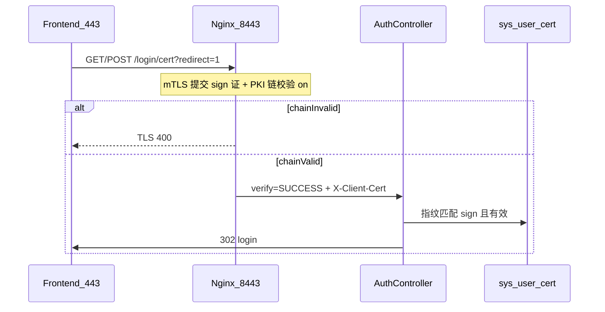

# Spring Boot Backend Skeleton v1.0 + 可选证书模块

> 基于 personalDemo Backend 实践整理，用于**新项目从零搭架子**：工程结构、依赖、登录/JWT/Shiro 安全链路。  
> **v1.0** 为账密 + RBAC 核心骨架（§12 Checklist 1–17）；**§17** 为可选客户端证书 / mTLS 登录扩展。  
> 参考实现路径：`/mnt/d/javacode/personalDemo/backend`；证书部署细节见 [DEVELOPMENT.md §17](./DEVELOPMENT.md#17-客户端证书与-mtls-部署)。

---

## 1. 文档目标

| 目标 | 说明 |
|------|------|
| 统一工程结构 | 包划分、分层约定，后续业务按模块往里填 |
| 一次性导入基础依赖 | Web、MyBatis-Plus、JWT、Shiro、校验、AOP |
| 复用安全方案 | JWT Bearer + **Redis 实时会话 / DB 登录历史** + Shiro RBAC；不用 Servlet/Shiro HttpSession |
| **v1.0 三件套** | **统一异常/响应** + **操作日志落库** + **权限缓存失效**（见 §1.1） |
| **可选：客户端证登录** | mTLS + 指纹白名单（§17）；与账密共用 JWT / `sys_login_session` |
| 降低踩坑 | Kingbase 表名冲突、Shiro 注解不生效、代理 502、mTLS 443/8443 分工等 |

### 1.1 Skeleton v1.0 定义

v1.0 在「能登录、能鉴权、能 RBAC」之上，固化以下三项横切能力：

| 能力 | 包 / 表 | 要点 |
|------|---------|------|
| **统一异常/响应** | `common.result` / `common.exception` | 全 API `{ code, msg, data }`；业务/校验失败 HTTP 200 + `code=500`；403/401 见 §8.6 |
| **操作日志** | `common.aspect.LogAspect` + `common.operlog` + `sys_oper_log` | `@Log` 异步落库；与 `PermissionAspect` **分目录** |
| **权限缓存失效** | `security.cache.AuthorizationCacheEvictor` | 角色授权/用户绑角色后清 Shiro 授权缓存，免重新登录 |

**v1.0 完成标准：** §12 Checklist 1–17 全部打勾；改角色权限后**同 token** 下一次请求即生效；带 `@Log` 的接口能在 `sys_oper_log` 查到记录。

---

## 2. 推荐技术栈（与现项目一致）

| 类别 | 选型 | 版本 |
|------|------|------|
| Java | 1.8 | |
| Spring Boot | 2.6.x | 2.6.13 |
| ORM | MyBatis-Plus | 3.5.5 |
| 认证 | Apache Shiro + jjwt | 1.13.0 / 0.11.5 |
| 密码 | BCrypt（spring-security-crypto） | |
| 数据库 | KingbaseES / PostgreSQL 系 | 8.6.0 |
| 工具 | Lombok | |
| 证书签发（§17 可选） | BouncyCastle bcpkix-jdk15on | 1.70 |

---

## 3. 新建项目步骤

### 3.1 创建 Maven 工程

1. IDEA：**New Project → Maven → Java 8**
2. `groupId` 示例：`org.example`
3. `artifactId` 示例：`backend`
4. 根包名：`org.example.backend`

### 3.2 目录结构（骨架阶段应长这样）

```text
backend/
├── lib/                          # Kingbase 等本地 JAR（可选）
├── docs/
│   ├── API.md                    # 联调文档（业务阶段再写）
│   ├── SKELETON.md               # 本文档
│   ├── DEVELOPMENT.md            # 模块实现详解
│   └── DDD-DECOUPLING.md         # Impl 依赖与解耦路线图
├── scripts/
│   └── test-api.sh               # 冒烟测试
├── src/main/java/org/example/backend/
│   ├── BackendApplication.java
│   ├── config/                   # Shiro、MyBatis-Plus 等
│   ├── auth/                     # 登录、当前用户、登录设备会话
│   │   ├── controller/           # AuthController
│   │   ├── service/
│   │   ├── cert/                 # 可选：客户端证申请/签发/登录（§17）
│   │   │   ├── config/           # CertProperties
│   │   │   ├── constant/
│   │   │   ├── controller/       # UserCertController、CertManageController
│   │   │   ├── service/impl/     # CertApply、CertIssue、CertLogin
│   │   │   ├── listener/         # 用户状态变更事件监听（吊销证书）
│   │   │   ├── util/             # X509CertUtils、CertPathUtils
│   │   │   ├── entity/mapper/dto/vo/
│   │   ├── session/              # sys_login_session + 踢设备
│   │   │   ├── controller/
│   │   │   ├── service/
│   │   │   ├── listener/         # 用户状态变更事件监听（吊销会话）
│   │   │   ├── entity/
│   │   │   ├── mapper/
│   │   │   └── util/             # ClientIpUtils、UserAgentUtils
│   │   ├── dto/
│   │   └── vo/
│   ├── security/                 # 安全基础设施
│   │   ├── filter/               # JwtFilter
│   │   ├── realm/                # UserRealm
│   │   ├── token/                # JwtToken、ApiAuthToken
│   │   ├── aspect/               # PermissionAspect（权限）；勿与操作日志混放
│   │   ├── cache/                # AuthorizationCacheEvictor
│   │   ├── listener/             # 用户状态变更事件监听（清授权缓存）
│   │   └── context/              # LoginUserUtils
│   ├── api/                      # AK/SK 开放接口（可选）
│   │   └── listener/             # 用户状态变更事件监听（吊销 API Token）
│   ├── common/
│   │   ├── result/               # AjaxResult、ResultCode
│   │   ├── exception/            # BusinessException、GlobalExceptionHandler
│   │   ├── aspect/               # LogAspect 等横切行为（非权限）
│   │   ├── operlog/              # sys_oper_log 落库（v1.0）
│   │   ├── utils/                # 仅放真正跨域、无业务语义的少量工具
│   │   └── vo/                   # OptionVO、PageResultVO
│   ├── system/                   # RBAC（user/role/permission）
│   │   ├── user/
│   │   │   └── event/            # UserStatusChangedEvent（IAM 发布）
│   │   ├── role/
│   │   └── permission/
│   └── [业务模块]/               # asset、statistics 等后加
│       # asset 参考实现（可选 DDD 分层）：
│       # host/domain/ application/ infrastructure/
│       # port/ + infrastructure/acl/（跨上下文 UserQueryPort）
└── src/main/resources/
    ├── application.yml
    └── sql/
        ├── 01-create-tables.sql
        ├── 02-insert-data.sql
        ├── 21-login-session.sql   # 登录设备会话（已有库增量）
        ├── 22-oper-log.sql          # 操作日志表（v1.0，已有库增量）
        └── 22-user-cert.sql         # 客户端证书（可选，§17，已有库增量）
```

### 3.3 分层约定（每个业务模块）

```text
模块名/
├── controller/     # @RestController，@RequiresPermissions，@Valid
├── service/        # 接口 + impl，成功 void，失败 BusinessException
├── mapper/         # MyBatis-Plus BaseMapper
├── entity/         # @TableName
├── dto/            # 入参（POST/PUT body、Query 绑定）
└── vo/             # 出参
```

**约定：**

- GET 列表：QueryDTO + URL 参数，返回 `PageResultVO`
- 系统表关联字段：统一 `OptionVO { id, label }`

**进阶（可选）：** 写路径规则复杂、跨表需共进退时，可在模块内增加 `domain/`（聚合 + Repository 接口）、`application/`（用例 + `@Transactional`）、`infrastructure/`（Repository 实现）。参考实现见 `asset/host/` 与 [DDD-DECOUPLING.md](./DDD-DECOUPLING.md)。

### 3.4 工具类放哪（避免 `common.utils` 垃圾桶化）

`common.utils` **只放**真正跨模块、几乎无业务语义、长期稳定的 helpers（如 `PasswordUtils`）。  
一旦工具类**只服务某一领域**，应放在该领域包下，而不是继续堆进 `common`：

| 工具 | 推荐位置 | 原因 |
|------|----------|------|
| `ClientIpUtils`、`UserAgentUtils` | `auth.session.util` | 仅登录会话使用 |
| `X509CertUtils`、`CertPathUtils` | `auth.cert.util` | 仅客户端证书模块（§17） |
| `JwtUtils`、`ApiJwtUtils` | `security.util` 或 `auth.util` | 认证/JWT 领域 |
| `PasswordUtils` | `common.utils` 或 `security.util` | 通用密码哈希，无模块耦合 |
| 资产状态校验 | `asset.constant` / `asset.service` | 业务规则，不进 common |

**反模式：** 所有 `*Utils` 都往 `common.utils` 丢 → 新人无法判断依赖边界，改一处牵动全项目。  
**原则：** 先问「离开当前模块还有谁用？」——只有答案是「很多模块」时才进 `common`。

### 3.5 AOP 按职责分包（权限 ≠ 操作日志）

切面按**横切关注点**分包，**不要**把所有 `@Aspect` 塞进 `common.aspect` 一个目录：

```text
security/aspect/
├── PermissionAspect.java      # 统一权限检查
└── ...                        # 其它安全相关切面（若有）

common/aspect/                 # 或 audit/aspect/
├── LogAspect.java             # @Log 操作日志（控制台 + 落库）
└── ...                        # 其它与鉴权无关的横切（限流等）

security/cache/
└── AuthorizationCacheEvictor.java   # RBAC 变更后失效 Shiro 授权缓存
```

| 切面 | 包 | 职责 | 不要混在一起 |
|------|-----|------|----------------|
| **PermissionAspect** | `security.aspect` | `@RequiresPermissions` → `Subject.checkPermissions` | 与日志、事务无关 |
| **LogAspect** | `common.aspect` | `@Log` 记录入参/出参/操作类型并落库 | 与 Shiro 权限无关 |
| **AuthorizationCacheEvictor** | `security.cache` | 角色/用户 RBAC 变更后 `cache.remove(userId)` | 与 AOP 无关，由 Service 显式调用 |

**Order 建议：** `PermissionAspect` `@Order(0)`，日志 `@Order(100)`；未授权时默认不进入 LogAspect（权限切面先抛 403）。

---

## 4. pom.xml 依赖清单

### 4.1 必选依赖

```xml
<properties>
    <java.version>1.8</java.version>
    <spring-boot.version>2.6.13</spring-boot.version>
    <mybatis-plus.version>3.5.5</mybatis-plus.version>
    <jjwt.version>0.11.5</jjwt.version>
    <shiro.version>1.13.0</shiro.version>
</properties>

<!-- Web -->
<dependency>
    <groupId>org.springframework.boot</groupId>
    <artifactId>spring-boot-starter-web</artifactId>
</dependency>

<!-- MyBatis-Plus -->
<dependency>
    <groupId>com.baomidou</groupId>
    <artifactId>mybatis-plus-boot-starter</artifactId>
    <version>${mybatis-plus.version}</version>
</dependency>

<!-- JWT（三件套） -->
<dependency>
    <groupId>io.jsonwebtoken</groupId>
    <artifactId>jjwt-api</artifactId>
    <version>${jjwt.version}</version>
</dependency>
<dependency>
    <groupId>io.jsonwebtoken</groupId>
    <artifactId>jjwt-impl</artifactId>
    <version>${jjwt.version}</version>
    <scope>runtime</scope>
</dependency>
<dependency>
    <groupId>io.jsonwebtoken</groupId>
    <artifactId>jjwt-jackson</artifactId>
    <version>${jjwt.version}</version>
    <scope>runtime</scope>
</dependency>

<!-- Shiro -->
<dependency>
    <groupId>org.apache.shiro</groupId>
    <artifactId>shiro-spring-boot-starter</artifactId>
    <version>${shiro.version}</version>
</dependency>

<!-- 密码 BCrypt（只用 crypto，不引入完整 Spring Security） -->
<dependency>
    <groupId>org.springframework.security</groupId>
    <artifactId>spring-security-crypto</artifactId>
</dependency>

<!-- 参数校验 @Valid -->
<dependency>
    <groupId>org.springframework.boot</groupId>
    <artifactId>spring-boot-starter-validation</artifactId>
</dependency>

<!-- AOP：PermissionAspect（security）、LogAspect（common）分目录 -->
<dependency>
    <groupId>org.springframework.boot</groupId>
    <artifactId>spring-boot-starter-aop</artifactId>
</dependency>

<!-- Lombok -->
<dependency>
    <groupId>org.projectlombok</groupId>
    <artifactId>lombok</artifactId>
    <optional>true</optional>
</dependency>
```

### 4.2 Kingbase 本地 JAR（按需）

驱动与依赖 JAR 放 `lib/`，`pom.xml` 用 `scope=system` + `includeSystemScope=true`（见现项目 `pom.xml`）。

### 4.3 可选：客户端证书签发（§17）

```xml
<dependency>
    <groupId>org.bouncycastle</groupId>
    <artifactId>bcpkix-jdk15on</artifactId>
    <version>1.70</version>
</dependency>
```

### 4.4 启动类

```java
@SpringBootApplication
@EnableAspectJAutoProxy(proxyTargetClass = true)  // 必须：权限切面 + CGLIB 代理
@MapperScan({
    "org.example.backend.system.user.mapper",
    "org.example.backend.system.role.mapper",
    "org.example.backend.system.permission.mapper",
    "org.example.backend.auth.session.mapper",
    "org.example.backend.auth.cert.mapper"   // §17 可选
    // 业务 mapper 包后续追加
})
public class BackendApplication {
    public static void main(String[] args) {
        SpringApplication.run(BackendApplication.class, args);
    }
}
```

---

## 5. application.yml 模板

```yaml
spring:
  main:
    allow-bean-definition-overriding: true
  datasource:
    driver-class-name: com.kingbase8.Driver   # MySQL 则换驱动
    url: jdbc:kingbase8://host:5432/db?...
    username: ${DB_USERNAME}
    password: ${DB_PASSWORD}

# Kingbase：避免 sys_user 与系统视图同名
mybatis-plus:
  global-config:
    db-config:
      schema: public

jwt:
  secret: ${JWT_SECRET}   # 至少 32 字符的随机字符串
  expire: 7200    # 秒，2 小时

# 可选：客户端证书（§17）
cert:
  storage-base-path: /path/to/ca/client/users
  intermediate-cert: /path/to/ca/intermediate/intermediate-ca.crt
  intermediate-key: /path/to/ca/intermediate/intermediate-ca.key
  root-cert: /path/to/ca/root/root-ca.crt   # 仅公钥，打入用户 bundle.zip
  default-valid-days: 365
  p12-password-length: 16
```

---

## 6. 安全模块：整体流程

```text
┌─────────────┐     POST /login      ┌──────────────┐
│   前端      │ ──────────────────► │ AuthController│  记录 IP / User-Agent
└─────────────┘                     └──────┬───────┘
                                         │ 校验用户名密码(BCrypt)
                                         │ admin → 先吊销旧会话
                                         ▼
                                  ┌──────────────────┐
                                  │ LoginSessionService│ createSession → sessionId
                                  └──────┬───────────┘
                                         ▼
                                  ┌──────────────┐
                                  │  JwtUtils    │ 签发 JWT（jti=sessionId, sub, userId）
                                  └──────┬───────┘
                                         │ 返回 token + sessionId + userInfo
┌─────────────┐  Authorization: Bearer  │
│   前端      │ ───────────────────────►│
└─────────────┘                         ▼
                                  ┌──────────────┐
                                  │  JwtFilter   │ Shiro 过滤器链 /** → jwt
                                  └──────┬───────┘
                                         │ executeLogin(JwtToken)
                                         ▼
                                  ┌──────────────┐
                                  │  UserRealm   │ parseToken → assertSessionActive(jti)
                                  └──────┬───────┘  principal=userId
                                         ▼
                                  ┌──────────────┐
                                  │ Controller   │
                                  └──────┬───────┘
                                         │ @RequiresPermissions
                                         ▼
                                  ┌──────────────────────┐
                                  │ PermissionAspect      │ @RequiresPermissions
                                  └──────────────────────┘
                                         │ 触发 UserRealm.doGetAuthorizationInfo
                                         ▼
                                  从 DB 加载 roles + permissions
```

**证书登录（可选，§17；443 账密 + 8443 mTLS）：**

```text
443 /login 点击「证书登录」
    → 整页跳转 https://{host}:8443/login/cert?redirect=1
    → TLS 提交 sign.p12
    → Nginx 8443 请求客户端证书（ssl_verify_client optional_no_ca）
    → 后端仅接受 verify=SUCCESS；失败时重定向登录页
    → Nginx 注入 X-Client-Verify=SUCCESS / X-Client-DN / X-Client-Cert
    → GET 返回自动 POST 表单 → POST /login/cert
    → CertLoginService 指纹匹配 sys_user_cert（sign、有效）
    → issueLoginSuccess(..., login_type=1)  // 与账密共用 JWT 签发
    → 302 https://{host}/login#certLogin={Base64 LoginVO}
    → 443 登录页解析 hash 写入 token，后续 API 同账密登录
```



**登录态模型（避免与「无 Session」旧说法混淆）：**

| 层级 | 是否使用 | 说明 |
|------|----------|------|
| Servlet / Shiro **HttpSession** | **否** | `ShiroConfig` 里 `setSessionStorageEnabled(false)`，服务端不建 JSESSIONID |
| **JWT Bearer** | 是 | 客户端持 `Authorization: Bearer`；无服务端 Session Cookie |
| **`sys_login_session`（DB）** | 是 | 每次 Web 登录一条记录；JWT 的 `jti` = `session_id`；`login_type`：`0` 账密 / `1` 证书；用于登出、踢设备、全用户单点 |

因此：**不是**纯无状态 JWT——JWT 仍自包含 userId，但**能否继续用**以 Redis `personal-demo:session:{jti}` 为准，DB `sys_login_session` 保留登录历史。**全用户单点**：新登录前吊销旧会话；logout/kick 删除 Redis 并将 DB 标为下线，下次请求 401。

**AK/SK 开放接口**不走 Web 登录会话；使用 `personal-demo:api-token:{accessKey}` 缓存，未命中回源 `api_token` 表，吊销时同步删除缓存。

**两层安全：**

1. **认证（Authentication）**：JwtFilter + UserRealm — 你是谁？token 有效吗？
2. **授权（Authorization）**：`@RequiresPermissions` + **`security.aspect.PermissionAspect`** — 你能调这个接口吗？（与操作日志切面分离，见 §3.5）

---

## 7. 安全模块：文件清单与职责

| 文件 | 包路径 | 职责 |
|------|--------|------|
| `JwtToken` | `security.token` | Shiro 的 AuthenticationToken，principal/credentials 均为 JWT 字符串 |
| `JwtFilter` | `security.filter` | 拦截除 anon 路径外所有请求；解析 `Authorization: Bearer`；401 返回 JSON |
| `UserRealm` | `security.realm` | 验签 JWT；校验 `jti` 会话在线；principal 存 **userId(Long)** |
| `LoginSessionService` | `auth.session.service` | 创建/吊销会话；列表；踢设备；admin 登录前 revokeAll |
| `LoginSessionController` | `auth.session.controller` | `GET /system/session`、`DELETE /system/session/{id}` |
| `ClientIpUtils` / `UserAgentUtils` | `auth.session.util` | 登录时解析 IP、设备名 |
| `CertLoginServiceImpl` | `auth.cert.service.impl` | 读 Nginx 头，`X-Client-Cert` 指纹查 `sys_user_cert`（§17；前提：8443 链已通过） |
| `CertIssueServiceImpl` | `auth.cert.service.impl` | BouncyCastle 签 sign/encrypt，生成 bundle.zip（§17） |
| `CertApplyServiceImpl` | `auth.cert.service.impl` | 申请/审批/重发/吊销/下载（§17） |
| `X509CertUtils` | `auth.cert.util` | 解析 `X-Client-Cert`；`verify=NONE` 拒绝；`FAILED` 为代码兼容（nginx `on` 下正常路径为 SUCCESS） |
| `UserCertController` | `auth.cert.controller` | `/system/cert/mine/*` |
| `CertManageController` | `auth.cert.controller` | `/system/cert/*` 管理端 |
| `ShiroConfig` | `config` | SecurityManager、Filter 链；`/login`、`/login/cert*` = anon；`/**=jwt` |
| `PermissionAspect` | `security.aspect` | 拦截 `@RequiresPermissions` |
| `AuthorizationCacheEvictor` | `security.cache` | RBAC 变更后失效 Shiro 授权缓存 |
| `UserStatusChangedAuthCacheListener` | `security.listener` | 监听用户停用/删除，清授权缓存 |
| `LogAspect` | `common.aspect` | 拦截 `@Log`，异步写 `sys_oper_log` |
| `AuthorizationCacheEvictor` | `security.cache` | RBAC 变更后清除 Shiro 授权缓存 |
| `JwtUtils` | `security.util`（推荐） | 登录 JWT 签发/解析；现项目暂在 `common.utils`，宜迁移 |
| `ApiJwtUtils` | `security.util`（推荐） | AK/SK JWT；现项目暂在 `common.utils` |
| `PasswordUtils` | `common.utils` | BCrypt 加密与比对 |
| `LoginUserUtils` | `security.context` | `SecurityUtils.getSubject().getPrincipal()` → userId |
| `AuthController` | `auth.controller` | `POST /login`、`POST /logout`、`GET /user/info`；§17：`GET/POST /login/cert`、`/login/cert/check` |
| `GlobalExceptionHandler` | `common.exception` | 401/403/业务异常 → AjaxResult |

---

## 8. 核心代码要点（拷贝时对照）

### 8.1 JwtFilter 关键逻辑

```java
// 1. /login 放行
// 2. 无 Bearer token → HTTP 401 + AjaxResult
// 3. 有 token → executeLogin → UserRealm 验签
// 4. OPTIONS 预检放行（前后端分离时需要）
```

参考：`security/filter/JwtFilter.java`

### 8.2 UserRealm 关键逻辑

```java
@Override
public boolean supports(AuthenticationToken token) {
    return token instanceof JwtToken;  // 只处理 JWT
}

@Override
protected AuthenticationInfo doGetAuthenticationInfo(AuthenticationToken token) {
    // parseToken → 取 userId、jti
    // loginSessionService.assertSessionActive(jti)  // 已踢出/不存在 → AuthenticationException
    // SimpleAuthenticationInfo(userId, tokenStr, realmName)
    // principal 必须是 userId，后续 LoginUserUtils 才能用
}

@Override
protected AuthorizationInfo doGetAuthorizationInfo(PrincipalCollection principals) {
    Long userId = (Long) principals.getPrimaryPrincipal();
    // 查 sys_role、sys_permission → setRoles / setStringPermissions
}
```

参考：`security/realm/UserRealm.java`

### 8.3 ShiroConfig 过滤器链

```java
chain.put("/login", "anon");
chain.put("/login/cert", "anon");
chain.put("/login/cert/check", "anon");
chain.put("/login/cert/debug", "anon");
chain.put("/**", "jwt");
```

**不要**在 Filter 链里配 `perms[xxx]`，接口权限用 Controller 注解 + Aspect。

**说明：** 关闭的是 Shiro **HttpSession 存储**，不是取消登录会话；Web 登录会话由 `sys_login_session` + JWT `jti` 维护（见 §6）。

参考：`config/ShiroConfig.java`

### 8.4 PermissionAspect（必加）

```java
@Aspect @Component @Order(0)
public class PermissionAspect {
    @Before("@annotation(requiresPermissions)")
    public void checkPermission(RequiresPermissions requiresPermissions) {
        Subject subject = SecurityUtils.getSubject();
        subject.checkPermissions(requiresPermissions.value());
    }
}
```

参考：`security/aspect/PermissionAspect.java`

### 8.5 LogAspect + sys_oper_log（v1.0）

```java
@Aspect @Component @Order(100)
public class LogAspect {
    @Around("@annotation(log)")
    public Object around(ProceedingJoinPoint pjp, Log log) { ... }
}
```

- 放在 **`common.aspect`**，**不要**与 `PermissionAspect` 合并
- `@Log` 标注在 Controller 方法；敏感字段用 `excludeParamNames`（如 `passWord`）
- 落库：`common.operlog` + `SysOperLogService.saveAsync` + 表 `sys_oper_log`
- 需 `@EnableAsync` + 专用线程池（`config/AsyncConfig.java`）

参考：`common/aspect/LogAspect.java`、`resources/sql/22-oper-log.sql`

### 8.6 统一异常 / 响应（v1.0）

**响应体（全 API）：**

```json
{ "code": 0, "msg": "操作成功", "data": { } }
```

| 场景 | HTTP | body.code | 处理位置 |
|------|------|-----------|----------|
| 成功 | 200 | 0 | Controller 返回 `AjaxResult.success` |
| 业务失败 / 参数校验 | 200 | 500 | `BusinessException` / `@Valid` → `GlobalExceptionHandler` |
| 无接口权限 | 403 | 500 | `AuthorizationException` → `GlobalExceptionHandler` |
| 未登录 / token 无效 | 401 | 500 | `JwtFilter` 直接写 JSON（不经 Handler） |

**Service 约定：** 成功 `void`；可预期失败 `throw new BusinessException(ModuleType.XXX, "msg", null)`。

参考：`common/result/AjaxResult.java`、`common/exception/GlobalExceptionHandler.java`

### 8.7 权限缓存失效（v1.0）

Shiro `UserRealm` 会缓存 `AuthorizationInfo`（按 userId）。改 RBAC 后须失效，否则同 token 仍用旧权限。

```java
// ShiroConfig：启用 MemoryConstrainedCacheManager + authorizationCachingEnabled
userRealm.setAuthorizationCachingEnabled(true);
userRealm.setCacheManager(shiroCacheManager);

// RBAC 写操作后：
authorizationCacheEvictor.evictByUserId(userId);      // 用户绑角色
authorizationCacheEvictor.evictByRoleId(roleId);     // 角色授权 / 删角色
```

**调用点：** `SysUserServiceImpl.assignUserRoles`、`SysRoleServiceImpl.assignPermissionsForRole`、`deleteRole`。

用户**停用 / 删除**时的 `evictByUserId` 改由 `UserStatusChangedAuthCacheListener` 监听事件触发（见 §8.8），不再由 `SysUserServiceImpl` 直接调用。

参考：`security/cache/AuthorizationCacheEvictor.java`

### 8.8 用户状态变更事件（停用 / 删除级联）

IAM 上下文（`system/user`）在停用或删除用户时**只改库并发布事件**，不直接依赖 Auth、API、Cert、Security 模块，避免 `SysUserServiceImpl` 与 `LoginSessionService` 的 `@Lazy` 循环依赖。

**事件：** `system/user/event/UserStatusChangedEvent.java`

| ChangeType | 触发时机 |
|------------|---------|
| `DISABLED` | `updateUser`：`status` 从 `0`（正常）→ `1`（停用） |
| `DELETED` | `deleteUser`：`removeById` 成功后 |

**发布：** `SysUserServiceImpl` 注入 `ApplicationEventPublisher`，在 `@Transactional` 方法内 `publishEvent`；各 Listener 使用 `@TransactionalEventListener(phase = AFTER_COMMIT)`，保证 DB 提交后再清 Redis / 缓存。

**Listener（各模块自行订阅）：**

| Listener | 包路径 | 动作 |
|----------|--------|------|
| `UserStatusChangedSessionListener` | `auth/session/listener/` | `revokeAllActiveSessions` |
| `UserStatusChangedApiTokenListener` | `api/listener/` | `revokeAllByUserId` |
| `UserStatusChangedCertListener` | `auth/cert/listener/` | `revokeUserActiveCerts` |
| `UserStatusChangedAuthCacheListener` | `security/listener/` | `evictByUserId` |

```text
SysUserServiceImpl.updateUser / deleteUser
  → updateById / removeById
  → publish UserStatusChangedEvent
  → [AFTER_COMMIT]
       ├─ SessionListener   → Redis + sys_login_session
       ├─ ApiTokenListener  → Redis + api_token
       ├─ CertListener      → sys_user_cert
       └─ AuthCacheListener → Shiro AuthorizationInfo 缓存
```

**访问控制与数据一致性：**

- **踢在线用户：** Session Listener 清 Redis；兜底为 `UserRealm` → `assertUserActive`（查 `sys_user.status`）。
- **阻止重新登录：** 账密 / 证书登录均在 `AuthServiceImpl` 第二段校验 `status == 正常`。
- Cert / ApiToken / AuthCache Listener 主要保证**凭证表与缓存状态一致**，非额外安全防线；Listener 内 `try-catch` 打日志，单个失败不阻断其余订阅者。

参考：`system/user/service/impl/SysUserServiceImpl.java`、各 `*Listener.java`

### 8.9 全局异常（403 等）

```java
@ExceptionHandler(AuthorizationException.class)
@ResponseStatus(HttpStatus.FORBIDDEN)
public AjaxResult handleAuthorizationException(AuthorizationException e) {
    return AjaxResult.error("无权限访问", null);
}
```

参考：`common/exception/GlobalExceptionHandler.java`

### 8.10 登录 / 登出接口

```java
@PostMapping("/login")
public AjaxResult login(@Valid @RequestBody LoginDTO dto, HttpServletRequest request) {
    return AjaxResult.success("登录成功", authService.login(dto, request));
}

@PostMapping("/logout")
public AjaxResult logout(HttpServletRequest request) {
    authService.logout(request);  // 吊销当前 jti 对应会话
    return AjaxResult.success("退出成功", null);
}

@GetMapping("/user/info")
public AjaxResult getInfo() {
    return AjaxResult.success("成功", authService.getCurrentUser());
}
```

- `/login`：匿名；成功后返回 `{ token, sessionId, user }`
- `/logout`：登录即可；前端退出时先调再清 localStorage
- `/user/info`：登录即可，**不需要** `@RequiresPermissions`

**AuthServiceImpl.login 要点：**

```text
1. 校验用户名密码
2. loginSessionService.createSingleLoginSession(userId, ip, userAgent, loginType=0) → sessionId
3. jwtUtils.createToken(userId, userName, sessionId)
4. 返回 LoginVO { token, sessionId, user }
```

**AuthServiceImpl.loginByCert 要点（§17）：**

```text
1. certLoginService.resolveUserIdFromRequest(request)  // 指纹 → userId
2. loginSessionService.createSingleLoginSession(userId, ip, userAgent, loginType=1)
3. jwtUtils.createToken(...) → LoginVO
4. redirect=1 时 302 → https://{host}/login#certLogin={Base64 LoginVO}
```

账密与证书登录共用 `issueLoginSuccess(..., loginType)`，仅 `login_type` 与认证入口不同。

### 8.11 证书登录要点（§17 可选）

- **443 不做 mTLS**；**8443** 专口；前端 `window.location` 整页跳转，不用 XHR
- Nginx 8443：`ssl_verify_client **on**`（强制 mTLS + PKI 链必须通过）；转发 `X-Client-Verify`、`X-Client-DN`、`X-Client-Cert`
- **双层校验：** Nginx 验链；后端指纹白名单（`sys_user_cert`，仅 `sign` + `active`）
- 登录只匹配 **`cert_type=sign`** 且 **`status=0`** 的 `cert_fingerprint`
- 重发审批：`revokeUserActiveCerts` 吊销旧证 → 签新 sign/encrypt → bundle.zip 含 `root-ca.crt`、`intermediate-ca.crt`、p12、README（**不含 P12 密码**；用户平台一次性领取）
- 部署与踩坑详见 [DEVELOPMENT.md §17](./DEVELOPMENT.md#17-客户端证书与-mtls-部署)

---

## 9. RBAC 与登录会话数据库

### 9.1 RBAC（骨架阶段最少 5 张表）

```text
sys_user              用户
sys_role              角色
sys_permission        权限字符串（如 system:user:list）
sys_user_role         用户-角色
sys_role_permission   角色-权限
```

### 9.2 登录设备会话（推荐与 JWT 一起上）

```text
sys_login_session     登录会话（session_id = JWT jti）
  - user_id, device_name, login_ip, user_agent
  - login_time, status(0在线/1下线), revoke_time
  - login_type(0账密/1证书)          # 22-user-cert.sql 增量字段
```

**权限示例：**

| sys_permission | 说明 |
|----------------|------|
| `system:session:list` | 菜单 + 查设备（普通用户只看自己） |
| `system:session:kick` | 踢出设备 |
| `system:session:manage` | 仅 admin：查全部用户 + 踢任意会话 |

执行顺序：`01-create-tables.sql` → `02-insert-data.sql` →（已有库）`21-login-session.sql`

### 9.3 客户端证书（可选，§17）

v1.0 完成后按需执行 `22-user-cert.sql`：

```text
sys_cert_apply        申请单（new/reissue；pending/approved/rejected）
sys_user_cert         已签发证（sign/encrypt；指纹唯一；登录仅匹配 sign）
```

| 字段 / 索引 | 说明 |
|-------------|------|
| `sys_user_cert.cert_fingerprint` | SHA-256，UK；CertLoginService 匹配依据 |
| `sys_user_cert.cert_type` | `sign`（登录）/ `encrypt`（加密用途） |
| `sys_user_cert.status` | `0` 有效 / `1` 吊销 |

**权限示例：**

| sys_permission | 说明 |
|----------------|------|
| `system:cert:mine` | 我的证书：申请、重发、下载 |
| `system:cert:list` | 证书管理：列表 |
| `system:cert:approve` | 审批签发 |
| `system:cert:revoke` | 吊销 |

执行顺序：在 v1.0 与 `21-login-session.sql` 之后 → `22-user-cert.sql`

**权限字符串 = `@RequiresPermissions("xxx")` = 表 `sys_permission.sys_permission`**，三者必须完全一致。

### Kingbase 特别注意

- 表名 `sys_user` 与系统视图冲突
- Entity：`@TableName("sys_user")` + `mybatis-plus.global-config.db-config.schema: public`
- **手写 SQL JOIN 用户表**：写 `public.sys_user`，不要裸写 `sys_user`

---

## 10. 公共模块（骨架阶段一起建）

**`common` 只收横切基础设施**，不要把领域工具、权限切面都塞进来（见 §3.4、§3.5）。

| 类 | 包 | 作用 |
|----|-----|------|
| `AjaxResult` / `ResultCode` | `common.result` | 统一 `{ code, msg, data }` |
| `PageResultVO` / `OptionVO` | `common.vo` | 分页、下拉 |
| `BusinessException` | `common.exception` | 业务抛错 |
| `GlobalExceptionHandler` | `common.exception` | 业务/校验/403 → AjaxResult |
| `Log` + `LogAspect` | `common.annotation` / `common.aspect` | 操作日志 AOP |
| `SysOperLog*` | `common.operlog` | 操作日志落库（v1.0） |
| `AuthorizationCacheEvictor` | `security.cache` | RBAC 变更清 Shiro 缓存（v1.0） |
| `PasswordUtils` | `common.utils` | 仅保留少量真正通用的 utils |

---

## 11. MyBatis-Plus 配置

```java
@Configuration
public class MybatisPlusConfig {
    @Bean
    public MybatisPlusInterceptor mybatisPlusInterceptor() {
        MybatisPlusInterceptor interceptor = new MybatisPlusInterceptor();
        // Kingbase 用 PostgreSQL 方言分页
        interceptor.addInnerInterceptor(new PaginationInnerInterceptor(DbType.POSTGRE_SQL));
        return interceptor;
    }
}
```

---

## 12. 骨架阶段开发顺序（Checklist）

按顺序做，每步可 curl 验证：

- [ ] **1.** 创建 Maven 工程 + 目录结构  
- [ ] **2.** 写入 `pom.xml` 依赖，`mvn compile` 通过  
- [ ] **3.** `application.yml` 数据源 + jwt.secret  
- [ ] **4.** 执行 RBAC 五表 SQL + seed（admin/user 密码 123456）  
- [ ] **5.** v1.0 公共类：`AjaxResult`、`ResultCode`、`BusinessException`、`GlobalExceptionHandler`  
- [ ] **6.** `PasswordUtils`；JWT 工具放 `security.util`（现项目暂在 `common.utils`）；`JwtToken`  
- [ ] **7.** `LoginSessionEntity/Mapper/Service` + `sys_login_session` 表  
- [ ] **8.** `UserRealm`、`JwtFilter`、`ShiroConfig`（含 **授权缓存** + `MemoryConstrainedCacheManager`）  
- [ ] **9.** `PermissionAspect`（`security.aspect`）+ `@EnableAspectJAutoProxy`  
- [ ] **10.** `@Log` + `LogAspect` + `sys_oper_log` + `AsyncConfig`（**v1.0 操作日志**）  
- [ ] **11.** `AuthorizationCacheEvictor` + 在角色/用户 RBAC 写操作后调用（**v1.0**）  
- [ ] **12.** User 模块：Entity/Mapper/Service（至少 `getByUserName`、查权限）  
- [ ] **13.** `AuthController`：login 返回 token+sessionId；logout；`/user/info`  
- [ ] **14.** `LoginSessionController`：`GET /system/session`、`DELETE /system/session/{id}`  
- [ ] **15.** 写一个带 `@RequiresPermissions("system:user:list")` 的占位 Controller 测 403  
- [ ] **16.** 改 user 角色后**不重新登录**，下一次请求权限即更新（验缓存失效）  
- [ ] **17.** `scripts/test-api.sh`：登录 → 带 token 访问 → logout → 再访问 401  

**v1.0 完成标准：** admin 能登录；403/401 行为符合 §8.6；`sys_oper_log` 有 `@Log` 记录；RBAC 变更后同 token 权限即时刷新；admin 双端登录仅最新会话有效。

---

## 13. v1.0 之后按需扩展

| 模块 | 说明 |
|------|------|
| `auth/session/` | 登录设备管理（已纳入参考实现） |
| `auth/cert/` | 客户端证书 + mTLS 登录（已实现，见 §17） |
| 操作日志查询 API | `GET /system/operlog` + 菜单权限（表已有，接口可选） |
| `JwtUtils` 迁包 | `common.utils` → `security.util` |
| `asset/` | 业务模块示例：读全开、写 owner；参考实现含 **domain/application/Repository** 分层（见 [DDD-DECOUPLING.md](./DDD-DECOUPLING.md)） |
| `statistics/` | 仪表盘聚合 + ECharts VO |
| `quartz/` | 定时任务 Cron 调度 |
| `docs/API.md` | 前端联调文档 |
| `docs/DEVELOPMENT.md` | 各模块实现详解（含 §17 mTLS 部署） |
| `docs/DDD-DECOUPLING.md` | Impl 依赖矩阵、P0/P1 解耦、改后总览图 |

---

## 14. 踩坑清单

| 现象 | 原因 | 处理 |
|------|------|------|
| `@RequiresPermissions` 不生效 | Shiro Advisor 与 Spring AOP 冲突 | 加 `security.aspect.PermissionAspect` |
| 切面全堆 `common.aspect` | 权限与日志耦合，难维护 | 权限 → `security.aspect`；日志 → `common.aspect`（§3.5） |
| `common.utils` 膨胀 | 领域工具误放 common | 按 §3.4 回迁到所属模块 |
| user 能访问 admin 接口 | DB 角色误分配权限 | 查 `sys_role_permission` |
| `/system/user` 404 | 未 Rebuild，Controller 未编译 | Rebuild Project |
| JOIN sys_user 报 column 不存在 | 命中 Kingbase 系统视图 | 用 `public.sys_user` |
| curl 502 | WSL 走 http_proxy | `curl --noproxy '*'` |
| 401 但带了 token | Bearer 格式错 / token 过期 / **会话已下线** | 查 `sys_login_session.status`；重新登录 |
| 旧端仍在线 | 未做单点 | 登录前 `createSingleLoginSession` |
| 改权限后仍旧权限 | Shiro 授权缓存未失效 | 角色/用户 RBAC 写操作后调 `AuthorizationCacheEvictor`（§8.7） |
| debug-cert 200 但证书登录失败 | TLS 有证 ≠ 指纹在库；多为旧证/错证 | 删个人旧 sign 证、导新 p12；关浏览器重开；见 DEVELOPMENT §17.6 |
| debug-cert verify 非 SUCCESS | 证书未提交或链未通过 | `optional_no_ca` 会转交后端拒绝并重定向；检查 CA、issuer DN、sign 证 |
| 8443/login 误开 | 8443 无 SPA | `/login` → 302 回 443；其他路径 → 404 |
| 443 登录页选证后 400 | 443 误开 mTLS | 443 不配置 `ssl_verify_client`；证书登录仅 8443 |
| 重发后仍用旧证登录 | 浏览器缓存旧 sign 证 | 个人存储删旧证；必要时重启浏览器 |

---

## 15. 冒烟测试脚本（最小）

```bash
#!/usr/bin/env bash
BASE_URL="${BASE_URL:-http://localhost:8080}"

# 登录
TOKEN=$(curl -sS --noproxy '*' -X POST "$BASE_URL/login" \
  -H "Content-Type: application/json" \
  -d '{"userName":"admin","passWord":"123456"}' \
  | jq -r '.data.token')

# 带 token
curl -sS --noproxy '*' -H "Authorization: Bearer $TOKEN" "$BASE_URL/user/info"

# 登出
curl -sS --noproxy '*' -X POST -H "Authorization: Bearer $TOKEN" "$BASE_URL/logout"

# 登出后再访问 → 401
curl -sS --noproxy '*' -o /dev/null -w "%{http_code}" \
  -H "Authorization: Bearer $TOKEN" "$BASE_URL/user/info"

# 无 token → 401
curl -sS --noproxy '*' -o /dev/null -w "%{http_code}" "$BASE_URL/user/info"
```

---

## 16. 相关文件索引（现项目）

| 主题 | 路径 |
|------|------|
| 依赖 | `pom.xml` |
| 启动类 | `BackendApplication.java` |
| Shiro | `config/ShiroConfig.java` |
| JWT 过滤器 | `security/filter/JwtFilter.java` |
| Realm | `security/realm/UserRealm.java` |
| 权限切面 | `security/aspect/PermissionAspect.java` |
| 授权缓存失效 | `security/cache/AuthorizationCacheEvictor.java` |
| 用户状态变更事件 | `system/user/event/UserStatusChangedEvent.java` |
| 停用/删除级联 Listener | `auth/session/listener/`、`api/listener/`、`auth/cert/listener/`、`security/listener/` |
| 操作日志切面 | `common/aspect/LogAspect.java` |
| 操作日志落库 | `common/operlog/`、`resources/sql/22-oper-log.sql` |
| 异步配置 | `config/AsyncConfig.java` |
| JWT 工具 | `common/utils/JwtUtils.java`（宜迁至 `security/util`） |
| 登录会话 | `auth/session/service/LoginSessionService.java` |
| 登录设备 API | `auth/session/controller/LoginSessionController.java` |
| 登录 | `auth/controller/AuthController.java` |
| RBAC SQL | `resources/sql/01-create-tables.sql` |
| 会话 SQL | `resources/sql/21-login-session.sql` |
| 证书 SQL | `resources/sql/22-user-cert.sql`（§17） |
| 客户端证书 | `auth/cert/`（Apply / Issue / Login） |
| VmHost 聚合（Asset P1） | `asset/host/domain/model/VmHost.java` |
| Asset 应用层 | `asset/host/application/`、`asset/app/application/` |
| UserQueryPort | `asset/port/UserQueryPort.java` |
| 解耦总览 | `docs/DDD-DECOUPLING.md` |
| mTLS 部署文档 | `docs/DEVELOPMENT.md` §17 |
| 前端 API 文档 | `docs/API.md` |

---

## 17. 可选扩展：客户端证书与 mTLS 登录

> 完整 Nginx 配置、Windows 导入、踩坑表见 [DEVELOPMENT.md §17](./DEVELOPMENT.md#17-客户端证书与-mtls-部署)。本节只说明**骨架应长什么样**。

### 17.1 何时需要

- 内网系统要求 **客户端证（mTLS）登录**，公网 CA 无法签发 `clientAuth` 用户证
- 已有私有 PKI（Root → Intermediate → 用户 sign/encrypt 证）
- v1.0（账密 + JWT + RBAC）**已完成**

### 17.2 架构约束

| 约束 | 说明 |
|------|------|
| **443 / 8443 分工** | 443：SPA + `/api/*`（账密）；8443：mTLS 证书登录 |
| **443 不做 mTLS** | `ssl_verify_client` 只能配在 server 级，443 开启会波及登录页 |
| **前端不用 XHR** | 须 `window.location` 整页跳 8443；token 经 `#certLogin=` hash 回 443 |
| **后端验链与指纹** | Nginx 8443 使用 `optional_no_ca` 转发状态；后端只接受 `verify=SUCCESS`，再查 `sys_user_cert` 指纹白名单 |

### 17.3 后端包职责

| 类 | 职责 |
|----|------|
| `CertApplyServiceImpl` | 申请/重发/审批/拒绝/吊销/下载；重发时先 `revokeUserActiveCerts` |
| `CertIssueServiceImpl` | BouncyCastle 签 sign+encrypt；bundle 含 CA crt + p12 + README（无密码明文） |
| `CertLoginServiceImpl` | `X509CertUtils` 解析头 → 指纹 → userId |
| `UserCertController` | `/system/cert/mine/*` |
| `CertManageController` | `/system/cert/*`、`/system/cert/apply` |
| `AuthController` | `GET /login/cert`（自动 POST）、`POST /login/cert`、`/login/cert/check` |

### 17.4 Nginx 要点（详配见 DEVELOPMENT §17.2）

- 8443：`ssl_client_certificate`（intermediate+root bundle）、`ssl_verify_client **on**`
- location 转发：`X-Client-Verify`、`X-Client-DN`、`X-Client-Cert`
- 诊断：`/debug-cert`、`/cert-check` → 后端 `/login/cert/check`
- `optional_no_ca` 只负责避免 Nginx 提前返回 400；后端必须强制 `X-Client-Verify=SUCCESS`，不能仅凭收到证书就放行

### 17.5 可选 Checklist（18–22）

v1.0 Checklist 1–17 完成后：

- [ ] **18.** 执行 `22-user-cert.sql`；配置 `cert.*`；中间 CA 私钥权限收紧  
- [ ] **19.** 实现 `auth/cert` 三 Service + `X509CertUtils` + `CertProperties`  
- [ ] **20.** `AuthController` 证书登录 + Shiro anon（`/login/cert*`）  
- [ ] **21.** Nginx 8443（`ssl_verify_client optional_no_ca`）+ 后端强制 `verify=SUCCESS`；443 不启用 mTLS  
- [ ] **22.** 前端：证书登录按钮、`#certLogin` / `?certError` 回调（契约见 API.md §2.1.1）

### 17.6 常见踩坑（摘要）

| 现象 | 处理 |
|------|------|
| 443 选证后 400 | 443 不要 mTLS；仅 8443 |
| debug-cert OK 但登录报未绑定 | 旧 sign 证仍在浏览器；删个人旧证、导新 p12、重启浏览器 |
| debug-cert verify 非 SUCCESS | 8443 `on` 下链未通过；检查 CA 导入与 issuer DN |
| issuer DN 顺序导致 8443 400 | 签发时用 CA Subject 的 DER 作 issuer；重签用户证 |
| 8443 非证书路径 | `/login` → 302 回 443；其他 → 404 |
| 重发后旧证仍能 TLS 提交 | 服务端已吊销；客户端须删旧 p12 |

完整列表：[DEVELOPMENT.md §17.6](./DEVELOPMENT.md#176-常见问题与踩坑)

---

## 18. 安全加固基线

> 本节用于复用项目骨架时收紧认证、密钥和代理信任边界，作为开发与上线检查指南。等保定级、安全测评和渗透测试需按实际系统另行实施。

### 18.1 骨架安全能力

- **认证与会话：** BCrypt 密码哈希；JWT 含过期时间和 `jti`；`jti` 关联 `sys_login_session`，用于登出立即吊销、管理员踢设备、单用户会话和会话历史。
- **授权：** User → Role → Permission → `@RequiresPermissions` 的 RBAC 链路，业务资源另行执行 owner 级对象授权。
- **API Token：** 校验 JWT 签名、AK、数据库状态、过期时间和资源 Scope，并提供 Token 生命周期与吊销。
- **mTLS/PKI：** 可选的 Root CA → Intermediate CA → User Certificate 证书链、Nginx 8443 mTLS、证书 SHA-256 指纹绑定，以及申请、审批、签发、吊销、重发和有效期管理。
- **审计：** 操作日志、登录会话记录和基础脱敏。

### 18.2 上线前必须收紧的边界

#### 18.2.1 Secret 不得写入配置与 JAR

不得在 `application.yml` 中固定写入数据库密码、Web JWT Secret 和 API JWT Secret；这些内容会进入源码包及 JAR 的 `BOOT-INF/classes/application.yml`，获取 JAR 的人可直接解包读取。

生产环境至少应改为外部注入：

```yaml
spring:
  datasource:
    password: ${DB_PASSWORD}

jwt:
  secret: ${JWT_SECRET}
  api:
    secret: ${API_JWT_SECRET}
```

生产值由 Environment Variable 或 systemd `EnvironmentFile` 提供，后续可升级到 Vault/KMS/Secret Manager。已进入代码包或 JAR 的凭据应视为已泄露并完成轮换。

#### 18.2.2 用户停用必须完整阻断认证

用户模型含 `status` 字段时，密码登录和普通 JWT 校验链路都必须明确拒绝非正常状态用户。

**实现（事件驱动，见 §8.8）：** `SysUserServiceImpl` 更新 `status=停用` 或删除用户后发布 `UserStatusChangedEvent`；各模块 Listener 在事务提交后级联吊销凭证：

```text
updateUser(status: 正常→停用) / deleteUser
  → publish UserStatusChangedEvent
  → [AFTER_COMMIT]
       ├─ revokeAllSessions(userId)      # SessionListener
       ├─ revokeAllApiTokens(userId)     # ApiTokenListener
       ├─ revokeActiveCertificates(userId)  # CertListener（数据一致性）
       └─ evictAuthorizationCache(userId)   # AuthCacheListener
```

**访问控制防线（与 Listener 独立）：**

| 场景 | 拦截点 |
|------|--------|
| 重新账密登录 | `AuthServiceImpl.login` 查 `status == 正常` |
| 重新证书登录 | 证书指纹通过后，`AuthServiceImpl.loginByCert` 查 `status` |
| 已有 JWT / API Token 请求 | `UserRealm` → `assertSessionActive` / `assertTokenActive` + **`assertUserActive`** |

Listener 负责立即清 Redis 会话与凭证脏数据；`assertUserActive` 为 DB 侧兜底，保证停用后鉴权必失败。

#### 18.2.3 PKI 用户私钥和 CA 私钥治理

如果业务服务生成并长期保存用户私钥、P12 和 bundle，不得再将 P12 密码明文存库或与 P12 放在同一 ZIP 中，否则会失去“传输包泄露后的第二层保护”。

目标模型应为：

```text
客户端生成不可导出或受保护的 private key
  → 生成 CSR
  → CA 仅签署 CSR
  → 返回 certificate
```

私钥应尽可能不离开用户终端，高安全场景使用 TPM/SmartCard/USBKey。Root CA 应离线，Intermediate CA 宜迁入 HSM 或独立 CA 服务，Spring Boot 业务进程不应直接持有 CA Private Key。

#### 18.2.4 证书登录的 Trusted Proxy Boundary

实现 `X509CertUtils` 时不得只拒绝空值和 `NONE`，否则 `FAILED` 也会被交给指纹白名单处理。后端只接受：

```java
if (!"SUCCESS".equalsIgnoreCase(verify)) {
    return null;
}
```

这是 Trusted Proxy Boundary 问题：即使 Nginx 8443 已配置 `ssl_verify_client optional_no_ca`，攻击者一旦能直接访问 Spring Boot 8080，仍可伪造 `X-Client-Verify` 和 `X-Client-Cert`。必须同时建立纵深防御：

```text
Internet
  → Nginx（强制 mTLS，覆盖用户传入的 X-Client-* Header）
  → Spring Boot（仅接受 verify == SUCCESS）
```

- Nginx 与后端在同一主机时，Spring Boot 应绑定 `127.0.0.1:8080`。
- 跨 WSL/Windows、容器或独立主机部署时，应绑定专用内部接口，不能盲目使用回环地址。
- Firewall/安全组只允许可信 Nginx 节点访问 8080，禁止 Internet 直连。
- Nginx 在所有转发路径上显式重写 `X-Client-Verify`、`X-Client-DN` 和 `X-Client-Cert`，不透传客户端同名 Header。
- `/login/cert/check` 的 `ok` 也应仅在 `verify == SUCCESS` 时为 true。

#### 18.2.5 生产环境不得使用默认账号密码

初始化 SQL 和 README 中的 `admin/123456`、`user/123456` 不能进入生产部署链路。首次部署应随机生成 bootstrap password，通过安全渠道交付并强制首次登录修改；或从 `ADMIN_INITIAL_PASSWORD` 等外部 Secret 注入。生产初始化脚本不得携带固定凭据。

### 18.3 生产安全增强项

#### 18.3.1 登录防爆破与用户名枚举

`/login` 需要同时建立 IP 和账号维度的限流/失败计数，结合短期冻结或指数退避，并将“用户不存在”和“密码错误”统一为“用户名或密码错误”。不建议使用无期限的永久锁定，避免被用于账号 DoS。密码策略也应达到适用的 [OWASP ASVS 5.0 Authentication](https://cornucopia.owasp.org/taxonomy/asvs-5.0/06-authentication/01-authentication-documentation) 要求。

#### 18.3.2 API Secret 不得明文存库

不得在 `api_token.secret_key` 中明文保存完整 SK，否则数据库泄露后即可直接获得有效凭据。应仅保存 SK 的 SHA-256/HMAC 结果并使用安全比较；如果 SK 本身是可验签 JWT，可只保存 AK、状态、有效期和 Scope，而不保存完 SK。

#### 18.3.3 依赖和运行时维护基线

复制本骨架时不应继续把 JDK 8、Spring Boot 2.6.13 和 Apache Shiro 1.13.0 作为新的企业生产安全基线。Spring Boot 2.6.x 早已结束公开维护（参见 [Spring Boot 2.6.14 发布说明](https://spring.io/blog/2022/11/24/spring-boot-2-6-14-available-now/)）；Shiro 1.x 也已被后续主版本取代（参见 [Apache Shiro Security Reports](https://shiro.apache.org/security-reports.html)）。

应规划迁移到受支持的 JDK 17/21、Spring Boot 和 Shiro 版本，并在迁移后执行 SCA、SAST 与回归测试。版本选型应以实际升级时官方支持矩阵为准，不在本文档固化具体目标版本。

#### 18.3.4 其他信任边界

- `ClientIpUtils` 只应在请求确认来自可信代理时使用 `X-Forwarded-For`/`X-Real-IP`，否则操作日志 IP 可被伪造。
- `/login/cert/debug` 和 `/login/cert/check` 如作为匿名诊断接口，生产环境应通过 Profile 关闭或由 Nginx 禁止外部访问。

### 18.4 推荐实施顺序

1. **立即移除并轮换** DB/JWT/API Secret，生产环境改为外部 Secret 注入。
2. **让用户停用立即生效：** 登录与每次鉴权拒绝停用用户（`assertUserActive`）；事务提交后通过事件吊销 session、API Token、证书并清授权缓存（§8.8）。
3. 为 `/login` 加入 **IP + 账号维度限流、失败控制、指数退避和统一错误消息**。
4. API Token **不再明文保存 SK**。
5. 收紧 mTLS Trusted Proxy Boundary：后端强制 `X-Client-Verify == SUCCESS`，8080 只允许 Nginx 访问，Nginx 覆盖 `X-Client-*`。
6. 停止服务器长期明文保存用户私钥，P12 密码不得与 P12 放入同一 ZIP。
7. 将 CA 私钥从 Spring Boot 业务服务剥离，向离线 Root CA 和独立 CA/HSM 演进。
8. 关闭生产环境的 `/login/cert/debug` 和 `/login/cert/check`。
9. 清理生产初始化链路中的 `admin/123456` 等固定凭据。
10. 升级 JDK/Spring Boot/Shiro，然后重新执行 SCA、SAST 和安全回归测试。

新项目复用骨架时，前 5 项应在生产上线前完成；后续项应纳入安全迭代计划，并通过自动化测试、配置审查、SCA/SAST 和部署验收确认实施结果。

---

**下次新开项目：** 按 §12 Checklist 从 1 做到 17，即 **Spring Boot Backend Skeleton v1.0**；需要证书登录时再按 §17 做 18–22。业务模块往 `system/` 同级继续拆包即可。
