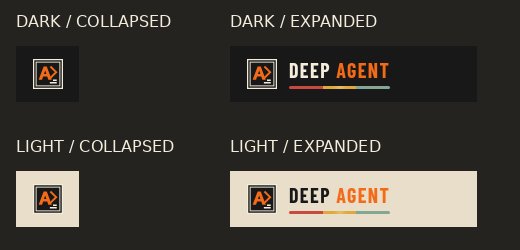

# PR #6 后续更新：工业品牌 Logo

在 PR #6 原分支上直接追加提交；不另建 PR，不合并 main。基线为 `98bb1ee`。

产品代码只修改两个文件：

- `frontEnd/src/components/BrandMark.vue`：原生 SVG 方形徽标，Carbon Black 底色、Warm Ivory 双层边框、Signal Orange 几何 A 与指令箭头，右下两条终端横线。图标内不绘制三色条。保留原有 `size?: number` 接口、32px 默认值和无障碍名称；侧栏仍传入 30px，登录页仍传入 36px / 40px。
- `frontEnd/src/layouts/AppLayout.vue`：字标中仅为 AGENT 添加橙色 span；DEEP 沿用现有明暗主题文字色。保留原字号、700 字重、间距、位置和占位。删除新 SVG 不再使用的浅色图标反相变量。PR #6 的三色条与反射 CSS 完全不变。

侧栏宽度仍为收起 64px、展开 248px；导航、点击区域、展开/收起动画及脚本逻辑均保持原样。全局主题和其他页面样式未修改；其他 BrandMark 使用位置自动获得新的 SVG。

本轮对话没有可读取的参考截图或 SVG 附件，因此按文字规格绘制，未声称完成与参考图的逐像素对照。

## 验证结果

- `npm run build`：通过，包含 `vue-tsc --build` 类型检查与 Vite 构建。
- `npm run test:e2e:office`：通过。
- `node --test agent-runtime/tests/{conversation,outputFiles,office-review,documents}.test.mjs`：34 项通过，0 失败。
- Chromium / Playwright：桌面 1440×1000、移动 390×844，分别检查深色与浅色，覆盖侧栏展开、收起及登录页；12 组前后对照中，品牌占位、图标尺寸、字标宽高及品牌以外元素的边界框与圆角一致。
- 30px 图标截图已目视检查。图标与完整字标块中心对齐；AGENT 为 `rgb(243, 107, 24)`，DEEP 随明暗主题切换。三色条与文字同宽。
- 复用的反射动画验证：10 秒周期，首尾位置一致，中点移动；减少动态效果时为 `animation: none`。原反射 CSS 与基线逐字一致，没有重复定义。
- 原 AppLayout 脚本与基线逐字一致。浏览器未记录页面错误，字体加载成功，登录页尺寸及位置不变。
- `git diff --check`：通过。

页面测试使用受控 API 数据，不代表真实后端登录或模型执行联调。

## 截图

下图由原始 Chromium 截图裁出的品牌区域并排组成，保留原生 30px 图标尺寸，没有缩放。

| 主题 / 设备 | 展开 | 收起 | 登录页 |
| --- | --- | --- | --- |
| 深色 / 桌面 | [截图](desktop-dark-expanded.png) | [截图](desktop-dark-collapsed.png) | [截图](desktop-dark-login.png) |
| 浅色 / 桌面 | [截图](desktop-light-expanded.png) | [截图](desktop-light-collapsed.png) | [截图](desktop-light-login.png) |
| 深色 / 移动 | [截图](mobile-dark-expanded.png) | [截图](mobile-dark-collapsed.png) | [截图](mobile-dark-login.png) |
| 浅色 / 移动 | [截图](mobile-light-expanded.png) | [截图](mobile-light-collapsed.png) | [截图](mobile-light-login.png) |
