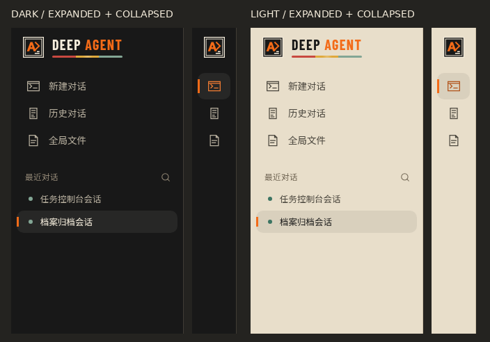

# PR #6 后续更新：菜单选中指示条

基于 PR #6 的 `a7f0bbd`，直接追加到原分支，不创建其他 PR、不合并 main。

品牌 SVG、双色字标、size 接口、占位及 10 秒三色条反射已在该基线实现，本次全部保留。

## 修改

- `frontEnd/src/layouts/AppLayout.vue`：复用 `.rail-item::before`，将指示器改为最左侧 3px 信号橙竖线。未选中 opacity 0；hover / focus-visible 为 0.35；`.rail-item-active` 与 `.recent-row-active` 为 1。选中规则优先于 hover，因此鼠标移出或继续悬停时，当前选中项都保持完整亮度。伪元素不接受鼠标事件。
- `frontEnd/src/components/AgentNav.vue`：只调整视觉选中绑定，沿用当前路由、workspaceView、activeSessionId 与已有展开属性。切换历史/文件视图时不再保留旧会话高亮；最近对话列表在收起时按原行为隐藏，由原 Agent 入口承接当前会话的选中反馈，展开后仍标记具体会话。没有新增状态或点击处理器，没有修改路由、会话操作、API 或工作区。

菜单高度、宽度、内边距、圆角、点击区域及侧栏展开/收起行为保持原值。原悬停过渡时长也保持不变。

## 验证

真实 Chromium + Playwright，桌面 1440×1000、移动 390×844，分别检查深色与浅色：

- 新建对话、历史对话、全局文件切换；未选中隐藏、悬停低亮度、选中完整亮度；选中项自身 hover 不变暗。
- 两个最近对话互相切换：旧会话竖线消失，新会话显示；鼠标移到品牌区域并清除焦点后仍显示，证明不是依赖 focus 实现。
- 会话切换到历史视图后，旧会话高亮取消；返回会话后恢复对应选中反馈。
- 侧栏移出收起为 64px，展开为 248px；会话与设置两类选中状态均在收起后保留。
- 用户管理与角色管理切换：旧路由指示取消，新路由指示显示，收起后平台设置入口仍选中。
- 32 组前后截图/几何对照：忽略有意变化的选中 class 后，元素数量、边界框、尺寸、圆角完全一致；浏览器无页面错误。
- `npm run build`（含类型检查）：通过。
- `npm run test:e2e:office`：通过。
- `node --test agent-runtime/tests/{conversation,outputFiles,office-review,documents}.test.mjs`：34 项通过，0 失败。
- `git diff --check`：通过。

测试使用受控 API 数据，没有进行真实后端写入或模型执行联调。

## 截图

下图为深浅主题下的会话选中状态，分别展示展开和收起；裁出侧栏顶部 440px，保留原像素尺寸。其他状态见完整页面截图。

| 场景 | 展开 | 收起 |
| --- | --- | --- |
| 深色桌面 / 角色管理 | [截图](desktop-dark-role.png) | [截图](desktop-dark-settings-collapsed.png) |
| 浅色桌面 / 当前会话 | [截图](desktop-light-session-two.png) | [截图](desktop-light-session-collapsed.png) |
| 深色移动 / 角色管理 | [截图](mobile-dark-role.png) | [截图](mobile-dark-settings-collapsed.png) |
| 浅色移动 / 当前会话 | [截图](mobile-light-session-two.png) | [截图](mobile-light-session-collapsed.png) |
